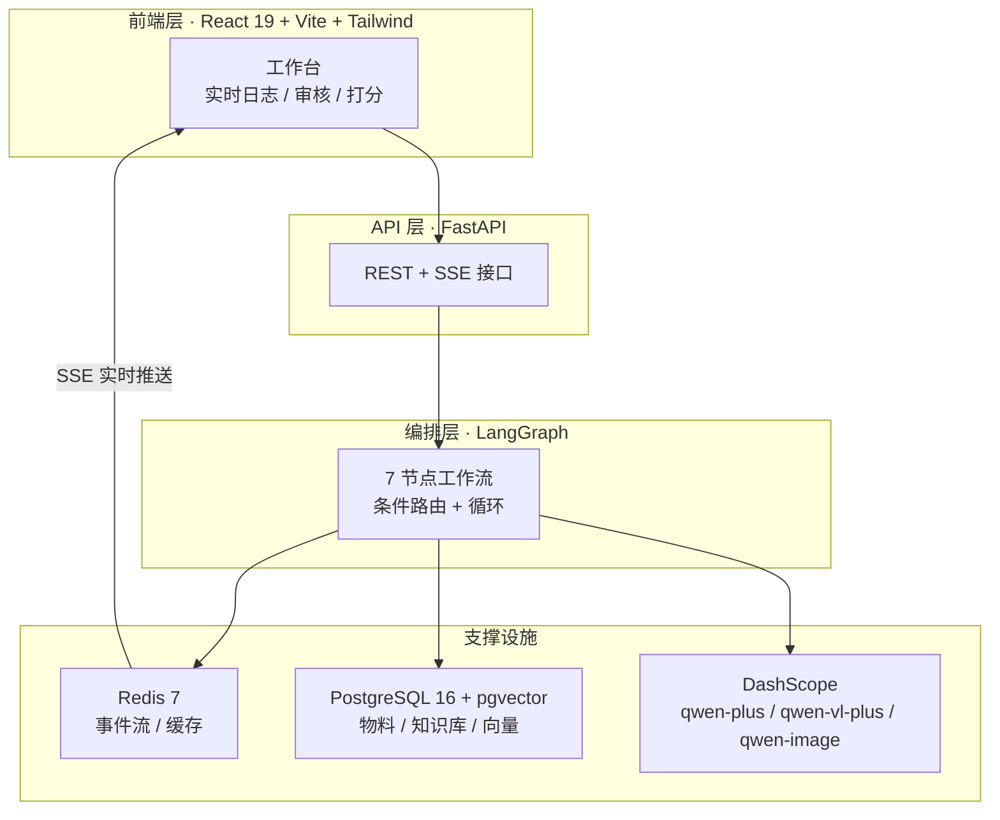
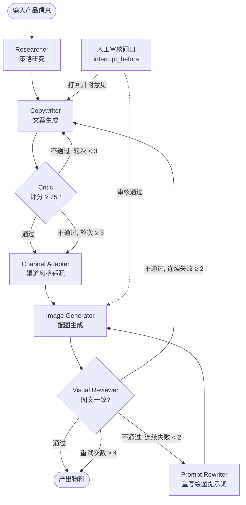
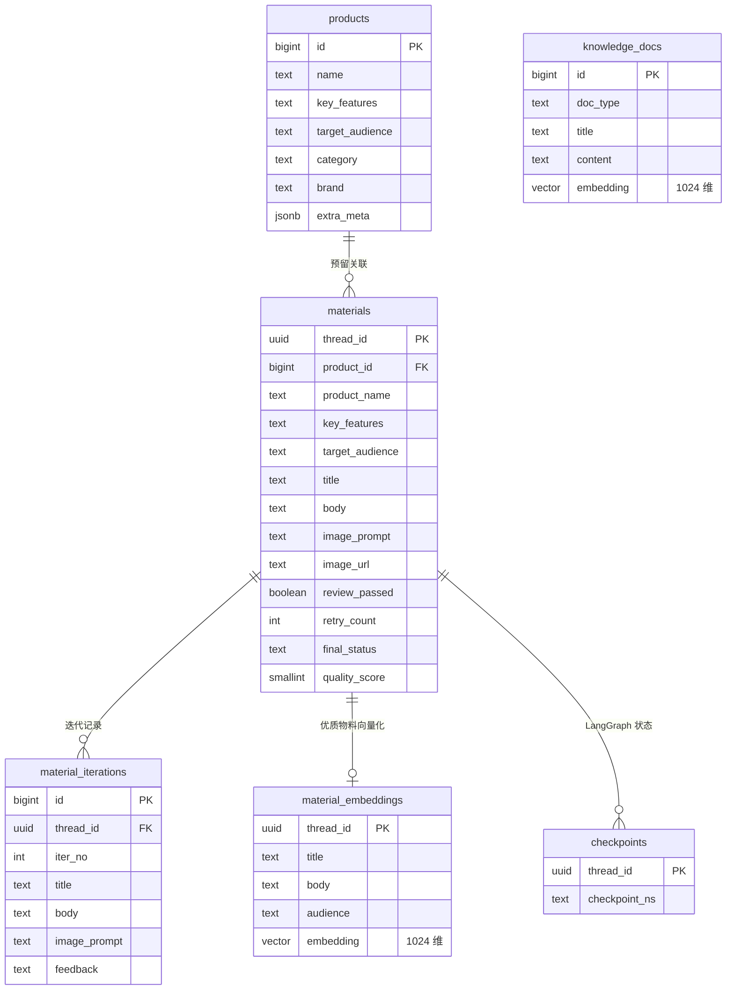

# 营销物料多智能体生成系统

> 输入产品信息，自动产出一套「标题 + 正文 + 配图」的营销物料。多个 Agent 分工协作、彼此互审、遇错回退，全过程实时可见。

基于 **LangGraph** 编排的多智能体工作流。区别于「单次调用大模型生成文案」，本系统把营销物料生产拆解成 7 个可独立审查的 Agent 节点，节点之间通过条件路由形成三条质量闭环，并在文案产出后设置**人工审核闸口**，最终由用户评分反向喂养 RAG 知识库。

**技术栈**：Python 3.11+ · FastAPI · LangGraph · PostgreSQL 16 + pgvector · Redis 7 · DashScope（通义千问）· React 19 + Vite + Tailwind CSS

---

## 目录

- [效果演示](#效果演示)
- [核心特性](#核心特性)
- [系统架构](#系统架构)
- [Agent 工作流详解](#agent-工作流详解)
- [工程难点与解法](#工程难点与解法)
- [技术栈](#技术栈)
- [快速开始](#快速开始)
- [API 文档](#api-文档)
- [数据模型](#数据模型)
- [目录结构](#目录结构)
- [已知限制](#已知限制)
- [License](#license)

---

## 效果演示

### 生成的营销配图

以下配图均由系统在本仓库中实际运行产出，非外部素材。

<table>
<tr>
<td align="center" width="33%"><br><sub>户外冲锋衣 · 登山场景</sub></td>
<td align="center" width="33%"><br><sub>雨季徒步 · 氛围场景</sub></td>
<td align="center" width="33%"><br><sub>农业无人机 · 作业场景</sub></td>
</tr>
</table>

### 一次完整任务的执行流

系统执行过程中，前端工作台会实时呈现每个节点的进展。下文「工程难点与解法」章节中的日志片段均来自真实运行。

```
🚀 后台任务已启动: 46971416-8e47-4abb-bcb2-8890ac4041f8
🔬 [Researcher] 正在分析产品信息并检索知识库...
✅ [Researcher] 策略分析完成！营销角度：场景化痛点切入...
✍️ [Copywriter] 正在基于研究员策略生成文案...
🤖 正在生成标题...
🔍 正在执行混合检索召回...
✅ 混合检索+重排序完成，已注入精准上下文...
🧐 [Critic] 第 1 轮文案审查中，正在严格挑刺...
❌ [Critic] 审查未通过（预估68分），正在生成修改意见...
📝 [Critic] 修改建议：标题缺少场景感，建议强化痛点...
🔄 [Copywriter] 收到 Critic 修改意见，正在优化文案（第 2 版）...
✅ [Critic] 审查通过！预估评分： 82 分
📱 [Adapter] 正在将文案适配为 【小红书】 风格...
✅ [Adapter] 风格适配完成！
🎨 [ImageGen] 正在根据 Prompt 生成图片...
📥 正在持久化图片到本地...
✅ 图片生成并持久化成功！
🔍 [首次审查] 正在调用视觉大模型进行图文一致性审查...
✅ [首次审查] 审查通过！图文一致性良好。
🎉 工作流全部执行完毕！
💾 物料基础信息已落库，请在完成后进行打分评价。
```

---

## 核心特性

| 特性 | 说明 |
|---|---|
| **多 Agent 协作流水线** | 7 个节点各司其职：策略研究 → 文案生成 → 质量审查 → 渠道适配 → 配图生成 → 图文审查 → 提示词重写。职责单一便于单独调优与复用 |
| **双层质量闭环** | 文本层：Critic 以 75 分为门槛审文案，不达标打回重写（最多 3 轮）。视觉层：多模态模型校验图文一致性，不达标改提示词重画 |
| **Human-in-the-loop** | 文案生成后工作流主动挂起，等待人工审核。通过则继续出图，打回则携带修改意见回退到 Copywriter 重写 |
| **跨模态反思** | 当视觉审查连续 2 次失败，判定问题根源在文案本身而非画图提示词，工作流自动回退到 Copywriter，要求其改写正文以适配画图 |
| **RAG 混合检索** | pgvector 向量召回（知识库 + 历史优质物料双路）→ LLM 精排 → 注入上下文。召回数量刻意放大 3 倍再精排，用大模型判断「是否真的相关」 |
| **自举飞轮** | 用户评分为 90 分以上的物料自动向量化入库，成为后续生成的 few-shot 范例。系统在无人干预下积累自己的优质语料 |
| **实时流式 + 断线续传** | 基于 Redis Stream + SSE。事件持久化在 Redis，客户端断线后凭 `Last-Event-ID` 从断点续传，不丢一个字 |
| **多渠道风格适配** | 同一份文案可改写为小红书（Emoji 密集 / 标题党 / Tag）或微信公众号（深度长文 / 专业客观）风格 |

---

## 系统架构



**分层要点**

- **编排层与执行层解耦**：`/api/start` 只负责启动后台任务并立刻返回 `thread_id`，长耗时的 Agent 执行不占用 HTTP 连接。
- **事件总线独立于请求生命周期**：Agent 产出的事件写入 Redis Stream 而非直接 push 给客户端，因此客户端断开不影响任务执行，重连后从断点续传。
- **状态持久化用 PostgreSQL 而非 Redis**：LangGraph Checkpointer 与业务数据同库，任务中断重启后工作流状态不丢。

---

## Agent 工作流详解



### 节点职责表

| 节点 | 输入 | 输出 | 调用模型 | 失败降级策略 |
|---|---|---|---|---|
| **Researcher** | 产品名、核心卖点、目标受众 | 卖点提炼、人群画像、语气、营销角度、关键词 | `qwen-plus` | 异常时降级为「无策略模式」，不阻塞流程 |
| **Copywriter** | 产品信息 + 研究策略 + RAG 上下文 | 标题、正文、绘图提示词 | `qwen-plus`（流式） | Redis 缓存命中直接返回；RAG 失败降级为无检索模式 |
| **Critic** | 标题 + 正文 + 研究策略 | 通过与否、修改意见、预估评分 | `qwen-plus` | 异常时兜底放行，不让审查环节卡死主流程 |
| **Channel Adapter** | 基础文案 + 目标平台 | 平台风格改写后的文案 | `qwen-plus` | 异常时返回原文案，不影响出图 |
| **Image Generator** | 绘图提示词 | 配图 URL | `qwen-image` / `wanx` | 指数退避重试 3 次；仍失败则跳过视觉审查，不阻塞交付 |
| **Visual Reviewer** | 配图 + 正文 | 图文是否一致、修改建议 | `qwen-vl-plus` | 模型异常兜底放行；连续 2 次失败触发跨模态反思 |
| **Prompt Rewriter** | 旧提示词 + 审查反馈 | 新绘图提示词 | `qwen-turbo` | 异常向上抛出终止本次生成 |

### 路由规则

**Critic 出口**（`route_after_critic`）

```python
if state.get("critic_passed") or state.get("copy_revision_count", 0) >= 3:
    return "adapt"     # 通过，或重写轮次耗尽 → 放行
return "rewrite"          # 不通过 → 回 Copywriter 重写
```

轮次上限的必要性：无上限的自我循环会烧掉 token 预算且无法收敛，3 轮是质量与成本的折中点。

**Visual Reviewer 出口**（`route_after_review`）

```python
if state.get("review_passed") or state.get("retry_count", 0) >= 4:
    return "end"        # 通过，或重试耗尽 → 结束
if state.get("cross_modal_feedback"):
    return "cross_modal_rewrite"   # 连续失败 → 跨模态反思，改文案
return "rewrite_prompt"             # 常规失败 → 改提示词重画
```

### 人工审核闸口

工作流在编译期设置了 `interrupt_before=["image_generator"]`：

```python
app = workflow.compile(
    interrupt_before=["image_generator"],
    checkpointer=checkpointer,
)
```

出图前强制挂起，由前端弹出审核框。两种决策对应两条完全不同的恢复路径：

```python
# 打回：携带意见跳转回 Copywriter
Command(goto="copywriter", update={"feedback": req.feedback})

# 通过：从中断点继续，不重跑已完成节点
None
```

这是 LangGraph 的核心能力——**恢复时不会重新执行已完成的节点**，一次任务里用户可以反复打回修改，成本远低于「重新生成」。

---

## 工程难点与解法

这一节记录开发中实际踩过的坑，以及最终的解法。

### 1. 长任务不能挂在 HTTP 连接上

Agent 全流程需要 1–3 分钟（多次模型调用 + 出图），若用 SSE 直连，客户端一断任务就死。

**解法**：三层解耦。
- `/api/start` 只启动 `asyncio.create_task` 后台任务，立刻返回 `thread_id`
- 事件写入 Redis Stream（`XADD`，`MAXLEN 500` 限制长度），与 HTTP 请求生命周期完全无关
- 前端用独立的 `GET /api/stream/{thread_id}` 订阅

### 2. SSE 断线重连要能续传

浏览器刷新、切后台、断网重连后，之前的文案流不能丢。

**解法**：Redis Stream 的消息 ID 直接作为 SSE 的 `id:` 字段下发，浏览器 EventSource 断线自动重连时会带上 `Last-Event-ID` 请求头：

```python
yield f"id: {msg_id_str}\ndata: {data_str}\n\n"
```

服务端按 `Last-Event-ID` 定位续传位置，同时支持 `?from=<msg_id>` 手动指定。

### 3. SSE 心跳不能用注释行

最初心跳发的是 SSE 注释行（`:` 开头），结果浏览器直接丢弃，前端看门狗计时器收不到任何数据，误判「后端失联」并主动断连。

**解法**：必须发真正的 `data` 事件：

```python
yield f"data: {json.dumps({'type': 'heartbeat'}, ensure_ascii=False)}\n\n"
```

### 4. 前端看门狗阈值不能设短

图像生成单节点耗时可达 60s+，期间没有任何业务事件推送。8 秒的心跳阈值会在节点正常执行期间误判断连。

**解法**：阈值提到 60 秒，靠心跳续命；节点正常执行时长只要在阈值内就不会误触。

### 5. 阿里云出图有两个不兼容的端点

`qwen-image-*` 与 `wanx*` 走的是完全不同的 DashScope 接口：

| 模型前缀 | 调用方式 | 取图路径 |
|---|---|---|
| `qwen-image` | `MultiModalConversation.call` | `output.choices[0].message.content[0]["image"]` |
| `wanx` | `dashscope.ImageSynthesis.call` | `output.results[0].url` |

用错端点时服务端只会回一句极具误导性的 `url error, please check url!`——和 URL 本身毫无关系，排查时极易跑偏。

**解法**：按模型前缀自动路由，并分别封装响应结构解析：

```python
def _is_qwen_image_model(model: str) -> bool:
    return (model or '').startswith('qwen-image')
```

### 6. asyncpg 不支持 pgvector 类型

asyncpg 没有内置 `vector` 类型支持，直接传 Python list 会报错。

**解法**：手动序列化后用 `$n::vector` 强转：

```python
vec_str = "[" + ",".join(map(str, embedding)) + "]"
await pool.execute("... VALUES ($1::vector)", vec_str)
```

### 7. Redis 密码为空时不能发 AUTH

redis-py 只有在 `password=None` 时才会跳过 AUTH，传入空字符串反而会报错。

**解法**：统一把空值归一化为 `None`：

```python
if not pwd:
    pwd = None
```

### 8. 大模型 JSON 输出不稳定

让模型输出严格 JSON，它可能返回带 markdown 代码块、字段缺失或类型不符的内容。

**解法**：`Tools/schema_tool.py` 中用 Pydantic Schema 约束，解析失败时把**具体校验错误**回喂给模型让它自修复，最多重试 2 次：

```python
except (json.JSONDecodeError, ValidationError) as e:
    prompt = f"""
    你之前的输出格式有误。原始要求：{prompt}
    你的错误输出：{response.output.text}
    具体的校验错误：{str(e)}
    请修正格式，重新输出正确的JSON。
    """
```

### 9. 全链路日志需要可追溯

Agent 在后台任务中执行，与 HTTP 请求不在同一调用链，普通的 request-id 关联不上。

**解法**：用 `ContextVar` 承载 trace_id，通过 loguru 的 `patcher` 注入每条日志。HTTP 入口从 `X-Trace-ID` 头继承，后台任务用 `thread_id` 前 8 位新建：

```python
logger.configure(patcher=lambda record: record["extra"].update(trace_id=trace_id_var.get()))
```

---

## 技术栈

| 分类 | 技术 | 用途 |
|---|---|---|
| **后端框架** | FastAPI · Uvicorn | 异步 REST API + SSE 流式响应 |
| **Agent 编排** | LangGraph | 状态机编排、条件路由、循环、Checkpointer 中断恢复 |
| **异步 IO** | asyncpg · redis(asyncio) | PostgreSQL 连接池、Redis 异步客户端 |
| **数据校验** | Pydantic v2 · pydantic-settings | Schema 约束模型输出、`.env` 配置管理 |
| **向量检索** | PostgreSQL 16 + pgvector | HNSW 向量索引 + 余弦相似度检索 |
| **缓存 / 队列** | Redis 7 | 事件总线（Stream）、任务状态（Hash）、结果缓存（String） |
| **大模型** | DashScope（通义千问） | `qwen-plus` 文本、`qwen-turbo` 轻量、`qwen-vl-plus` 视觉、`qwen-image`/`wanx` 出图、`text-embedding-v3` 向量 |
| **LLM 客户端** | openai SDK（兼容模式） | `stream_tool.py` 中做流式 token 解析 |
| **前端** | React 19 · Vite 8 · Tailwind CSS 3 | 界面与构建 |
| **流式客户端** | @microsoft/fetch-event-source | 支持 `Last-Event-ID` 的 SSE 客户端（原生 EventSource 不支持 POST） |
| **图标** | lucide-react | 界面图标 |
| **日志** | loguru | 格式统一、按天轮转、文件保留 7 天 |
| **容器化** | Docker Compose | Redis + pgvector 镜像一键起环境 |
| **兜底界面** | Streamlit | `app.py` 提供轻量 CLI 界面，便于无前端时验证接口 |

---

## 快速开始

### 1. 环境要求

- Python 3.11+
- Node.js 20+
- Docker + Docker Compose（用于启动 PostgreSQL 与 Redis）

### 2. 启动基础设施

```bash
docker compose up -d
```

将启动两个容器：

- `pgvector/pgvector:pg16` → `localhost:5432`，数据持久化到 `./data/pgdata`，首次启动自动执行 `init.sql` 建表
- `redis:7.2-alpine` → `localhost:6379`，开启 AOF 持久化

> `init.sql` 中已包含 `CREATE EXTENSION vector` 与 HNSW 索引创建，无需额外操作。

### 3. 配置环境变量

```bash
cp .env.example .env
```

编辑 `.env`，至少填入 `DASHSCOPE_API_KEY`（[阿里云百炼控制台](https://bailian.console.aliyun.com/)申请）以及数据库、Redis 的密码。

`POSTGRES_URI` 与 `REDIS_URL` 均由拆分变量自动拼接（`POSTGRES_USER` / `POSTGRES_PASSWORD` / `REDIS_PASSWORD` 等），一般无需手动填写。若连接的是远程库，直接写完整连接串覆盖即可。完整变量说明见 `.env.example` 内的注释。

### 4. 安装依赖并启动后端

```bash
pip install -r requirements.txt
python server.py
```

服务监听 `http://localhost:8000`，接口文档在 `http://localhost:8000/docs`。

> **Windows 用户注意**：Windows 默认的 Proactor 事件循环与 `asyncpg` 不兼容，需使用 Selector 事件循环。`server.py` 已内置处理，无需额外配置。

### 5. 灌入知识库（可选但推荐）

知识库存放品牌规范、优秀文案范例、视觉规范等，作为 RAG 的召回源：

```bash
python db/seed_knowledge.py
```

该脚本会调用 `text-embedding-v3` 将文档向量化后写入 `knowledge_docs` 表，**可重复执行**（同 title 覆盖更新，不会产生重复行）。

> 实现说明：脚本采用「先按 title UPDATE，未命中再 INSERT」的写法，**不依赖 title 上的唯一约束**。
> 原因是 `init.sql` 只在数据库首次初始化时执行一次，已有数据库不会重跑，约束可能缺失。
> 如果你想给现有库补上约束（可选，能让写入走更高效的路径）：
> ```bash
> # 注意：若表中已存在重复 title，需先清理重复行
> psql -U myuser -d marketing_db -c "ALTER TABLE knowledge_docs ADD CONSTRAINT uq_knowledge_docs_title UNIQUE (title);"
> ```

### 6. 启动前端

```bash
cd frontend
npm install
npm run dev
```

访问 `http://localhost:5173`。Vite 已配置 `/api` 代理到后端 `8000` 端口。

### 7. 完整体验流程

1. 左侧填写产品名称、核心卖点、目标受众，选择投放渠道
2. 点击「启动 Agent 工作流」，右侧实时观看 7 个节点执行
3. 文案生成后弹出**人工审核框**——可「审核通过，生成配图」，或填写意见「打回重写」
4. 配图产出并通过图文一致性审查后，为物料打分
5. **评分 ≥ 90 分**的物料自动向量化入库，下一次生成时会被检索为 few-shot 范例
6. 在「历史物料画廊」查看所有产出，支持分页、重新评分、删除

---

## API 文档

| 方法 | 路径 | 说明 |
|---|---|---|
| `POST` | `/api/start` | 启动工作流。请求体 `{product_name, key_features, target_audience, platform}`，返回 `{thread_id, status}` |
| `POST` | `/api/resume/{thread_id}` | 提交人工审核决策。请求体 `{approved: bool, feedback: str}`。`approved=false` 时携带 `feedback` 回退重写 |
| `GET` | `/api/stream/{thread_id}` | SSE 事件流。支持 `?from=<msg_id>` 指定续传位置，也支持 `Last-Event-ID` 头 |
| `GET` | `/api/tasks/{thread_id}/status` | 查询任务状态（前端轮询兜底） |
| `GET` | `/api/status/{thread_id}` | 查询 LangGraph 工作流状态与当前节点 |
| `GET` | `/api/history` | 历史物料列表，按评分降序优先 |
| `DELETE` | `/api/history/{thread_id}` | 删除物料及其向量、Checkpoint 记录 |
| `POST` | `/api/rate` | 提交评分。请求体 `{thread_id, score}`。≥90 分触发自动入库 |

### SSE 事件类型

| 事件类型 | 载荷 | 含义 |
|---|---|---|
| `init` | `{thread_id}` | 任务已创建 |
| `log` | `{content}` | 节点进展日志（带 emoji 的可读文本） |
| `title_chunk` | `{content}` | 标题增量文本 |
| `body_chunk` | `{content}` | 正文增量文本 |
| `finished` | `{thread_id, status, data}` | 任务结束。`status` 为 `finished` 或 `interrupted`（等待人工审核） |
| `error` | `{message}` | 执行出错 |
| `heartbeat` | `{}` | 心跳，2 秒一次，10 分钟无事件则发 `timeout` 后断开 |

前端 `api.js` 通过 `type` 分发到不同回调，逐字拼接实现打字机效果。

---

## 数据模型



| 表 | 职责 |
|---|---|
| `materials` | 物料主表。保存输入快照、生成结果、审查状态、用户评分。`quality_score` 驱动历史排序与 few-shot 筛选 |
| `material_iterations` | 迭代历史表，预留用于记录每轮重写的完整过程 |
| `knowledge_docs` | 知识库。`doc_type` 区分 `brand_guide` / `good_example` / `visual_guide` |
| `material_embeddings` | 优质物料向量表。只有评分 ≥ 90 的物料会写入，作为 few-shot 召回源 |
| `products` | 产品维度表，预留的产品库结构 |
| `checkpoints` | LangGraph Checkpointer 自动创建，存储工作流状态快照 |

**检索链路**：`query` → `text-embedding-v3` 向量化 → pgvector 余弦相似度召回（知识库 + 优质物料并行）→ LLM 精排（`qwen-turbo` 从候选中选 best_indices）→ 注入 Prompt 上下文。

召回时特意把 LIMIT 放大到 `k * 3` 再精排，用大模型判断「是否真的相关」——若精排后无高相关文档，宁可不注入 RAG 上下文，也不塞入噪声。

---

## 目录结构

```
.
├── agent/
│   └── graph_engine.py          # ⭐ LangGraph 工作流定义：7 个节点、条件路由、Checkpointer
├── app.py                       # Streamlit 兜底界面
├── server.py                    # FastAPI 入口：路由、SSE 响应、生命周期管理
├── task_manager.py              # 异步任务管理器：后台执行、事件发布、任务状态维护
├── stream_subscriber.py         # Redis Stream → SSE 转换，含断线续传与心跳
├── config.py                    # Pydantic Settings 配置中心
├── logger_config.py             # loguru 配置 + ContextVar trace_id 注入
├── db/
│   ├── db_repo.py               # 数据访问层：向量检索、LLM 精排、评分与落库
│   └── seed_knowledge.py        # 知识库初始化脚本
├── Tools/
│   ├── schema_tool.py           # Pydantic Schema 约束 + 自修复重试
│   ├── stream_tool.py           # 流式 token 解析（区分 title / body 字段边界）
│   ├── cache_tool.py            # Redis 连接池 + 缓存键生成
│   ├── image_store.py           # 远程图片下载与本地持久化
│   └── node_timer.py            # 节点耗时统计
├── frontend/
│   └── src/
│       ├── App.jsx              # 主界面：工作台 / 审核弹窗 / 评分 / 历史画廊
│       └── api.js               # SSE 客户端封装，看门狗 + 断线重连
├── docs/
│   └── images/                  # README 展示用的实跑产物配图
├── init.sql                     # 建表语句 + HNSW 向量索引
├── docker-compose.yml           # Redis + pgvector 编排
├── requirements.txt
└── .env.example                 # 环境变量模板
```

---

## 已知限制

诚实列出当前尚未实现的部分：

- **无多轮对话**：每次生成是独立任务，不支持基于上一轮继续追问
- **单实例部署**：后台任务跑在进程内 `asyncio.Task`，未接入 Celery / Arq 等外部任务队列，多副本部署会丢任务
- **无并发压测**：未做高并发场景的限流与性能验证（`server.py` 中的 IP 限流逻辑目前为注释状态）
- **未做图生视频**：出图之后的视频生成环节尚未接入
- **检索精度未评测**：RAG 链路缺少标准的召回率 / 准确率评测集，目前依赖 LLM 精排做启发式判断
- **`material_iterations` 表未接入**：迭代历史表已建但写入逻辑尚未实现

---

## License

[MIT](LICENSE)

模型服务由阿里云百炼（DashScope）提供，调用需自行申请 API Key 并承担相应费用。
